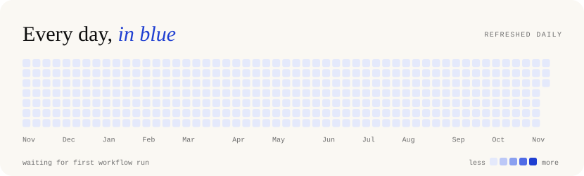
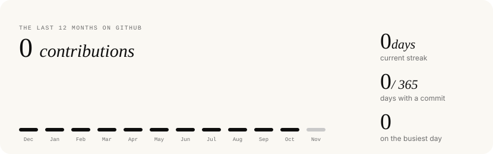
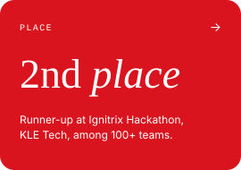
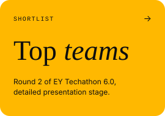
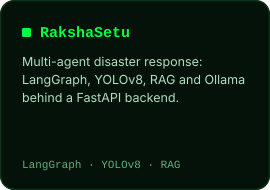
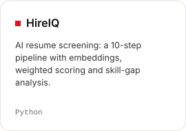
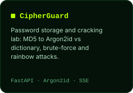

  
  
  

  
  
  

  <a href="mailto:koushiknayaka72@gmail.com">email</a> /
  <a href="https://www.linkedin.com/in/YOUR-LINKEDIN-HANDLE">linkedin</a> /
  <a href="https://github.com/Nayak72">github</a>

